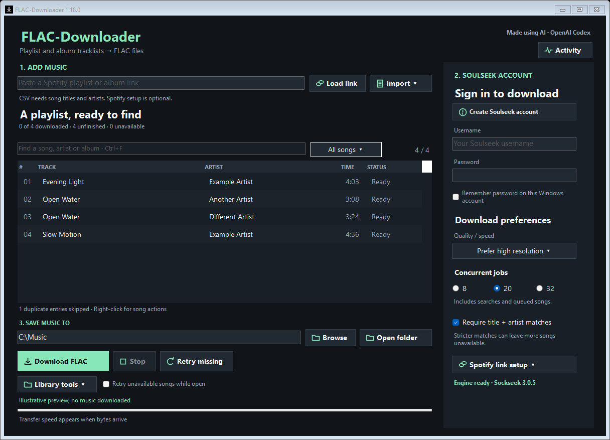

# FLAC-Downloader

> **Made using AI.** This application was designed and implemented with extensive assistance from **OpenAI Codex**, guided by human requests and testing. AI generated much of the code, tests, documentation, and interface work. See [AI disclosure](AI-DISCLOSURE.md).

A portable Windows desktop app for finding FLAC audio on Soulseek from a Spotify playlist, album, or CSV tracklist.

**Version: 1.19.4.** Start with the [quick start](docs/QUICKSTART.md), [interface guide](docs/UI-GUIDE.md), or [complete documentation index](docs/README.md).



## Download and use

Download the [Windows x64 portable ZIP](https://github.com/Eternal-Wisdom/FLAC-Downloader/releases/latest) from the [Releases page](https://github.com/Eternal-Wisdom/FLAC-Downloader/releases), extract the entire folder, and open **FLAC-Downloader.exe**. Windows 10/11 x64 and .NET Framework 4.8 are required. The executable is currently unsigned.

1. Enter your own Soulseek account. New to Soulseek? Follow the [account setup guide](docs/SOULSEEK-ACCOUNT.md). If another Soulseek client is using it, disconnect that client or use a separate account.
2. Paste a public Spotify album link and choose **Load link** (no developer setup), or use **Import** for a CSV or pasted songs. Spotify playlist links use the optional Web API connection.
3. Choose a destination and quality/speed preference, then select **Download FLAC**.

Public album import reads Spotify's public page metadata. Review the imported track count: regional availability and page formats can change, and empty, prerelease or very large public tracklists may need CSV instead. Album links first search shared album folders and prefer coverage before quality/speed. Only missing tracks with matching titles, artist/album folder labels and durations are requested; individual song searches fill gaps. Existing completed songs are skipped. This does not guarantee a single edition or lossless source provenance.

Spotify supplies metadata; audio is obtained from Soulseek peers. Availability, correctness, and speed depend on those peers. This app does not convert lossy files to FLAC or guarantee that a FLAC originated from a lossless source. Use it for music you are entitled to download and share. This project is not affiliated with Spotify, Soulseek, Nicotine+, or Sockseek.

## Features

- Public album links without developer credentials, optional authenticated playlist/album links, CSV and pasted-song import, Unicode search alternatives, and selected-song downloads.
- FLAC-only filtering; Fast FLAC, Balanced, and higher-resolution preference profiles.
- 8, 20, or 32 concurrent jobs. Jobs include searching and queued work, not just active transfers.
- Conservative duplicate recording detection and cross-collection reuse.
- Unnumbered playlist filenames and numbered album track order; artists are added when titles clash.
- Missing cover lookup, protected metadata edits, and FLAC header checks.
- Saved unavailable tracks with retries starting after 15 minutes and backing off to six hours. Launching or closing the app does not start background downloads.
- Search by song, artist, or album; filter the queue by status, with live source details.
- Repair previews, imported-album availability, and optional full audio verification using official FLAC tools.
- Resizable dark interface, status colors, action icons, and a live Activity window with a follow/pause control.
- Destination preflight checks, plain-language failure explanations and previewable privacy-safe diagnostics.

Formerly named Playlist FLAC. Existing settings and library metadata remain compatible.

Version 1.18.0 adds public album import, pasted tracklists, safer destination checks and allowlisted diagnostics. See the [improvement review](docs/REVIEW-IMPROVEMENT-IDEAS.md), [tracklist format guide](docs/CSV-FORMAT.md), [troubleshooting](docs/TROUBLESHOOTING.md), [changelog](CHANGELOG.md), and [validation results and limits](docs/VALIDATION.md).

## Clean folder layout

The portable download contains only the app, engine, guide, documentation, and license. It creates `state/` for private settings and caches. Source, test results, update archives, credentials, and music are excluded from release downloads.

```text
FLAC-Downloader/
  FLAC-Downloader.exe
  START HERE.txt
  LICENSE
  docs/
  engine/
```

Music goes directly into a named playlist or album folder. Playlists use song titles without numbering; albums use imported track order, including across discs:

```text
Music/
  My playlist/
    Song title.flac
    Same title (Other artist).flac
  Album name/
    01 - First song.flac
    02 - Second song.flac
```

Download indexes, reports, playback lists, locks and temporary transfer/repair files live in the app's private `state/collections/` storage. Completed jobs automatically clear staging, search maps and temporary repair backups. Stopped or failed jobs retain only the data needed to recover unfinished work. Keep `state/` when updating or moving the portable app: it contains resume information as well as settings. Existing hash-suffixed collection folders are discovered and organized during Download or Fix library; unrelated folders and unknown files are never overwritten. Same-name collections get a readable numeric suffix when necessary. See [folder and recovery details](docs/FOLDERS.md).

## Build and test

Windows PowerShell 5.1 and the .NET Framework compiler are sufficient; no Visual Studio installation is required.

```powershell
powershell -NoProfile -ExecutionPolicy Bypass -File scripts/Build.ps1
powershell -NoProfile -ExecutionPolicy Bypass -File scripts/Test.ps1
powershell -NoProfile -ExecutionPolicy Bypass -File scripts/Package.ps1
```

Build downloads the pinned Sockseek 3.0.5 Windows engine and checks the ZIP and executable hashes. Tests run in a separate executable against the built app and emit JUnit evidence in `build/test-results.xml` (suite counts, timestamps, revision and hashes). Test code is excluded from the portable app. Tests use synthetic local data and mock downloads; no account or network transfers are needed after engine setup. Source for the bundled engine is included in `third-party/` and in the portable release. See [release instructions](docs/RELEASING.md).

## Privacy and limitations

Settings, cached imports and retry lists stay in `state/` beside the app. Remembered Soulseek passwords are protected for the current Windows account using DPAPI. Spotify Web API tokens remain in memory; public album import does not use anonymous page tokens or preview audio. Soulseek credentials are temporarily written to a restricted engine configuration and removed after use; startup cleans abandoned configs under the session lease. Windows crash containment is best effort. Search queries are sent to Soulseek; public album import contacts Spotify and artwork lookup may contact Spotify, MusicBrainz, and the Cover Art Archive. Use **Library tools > Preview safe diagnostics** for a shareable version/policy/count report. Do not upload your state, music, debug logs, or real tracklists in bug reports.

The app is Windows-only. Spotify API access is subject to your developer app's current permissions. Albums import as individual tracks. Reported speed is approximate byte-progress telemetry. Quick FLAC checks inspect headers; optional full checks decode audio using an externally supplied official FLAC tool. Neither proves lossless provenance. No automatic updater or always-running background service is included.

## License and credits

FLAC-Downloader is released under **AGPL-3.0-only**. The independently launched [Sockseek](https://github.com/fiso64/sockseek) engine has its own upstream AGPL license and source. See [third-party notices](THIRD-PARTY-NOTICES.md). Contributions are welcome; please read [CONTRIBUTING.md](CONTRIBUTING.md).

The [documentation index](docs/README.md) separates current guides from dated research and review records.

